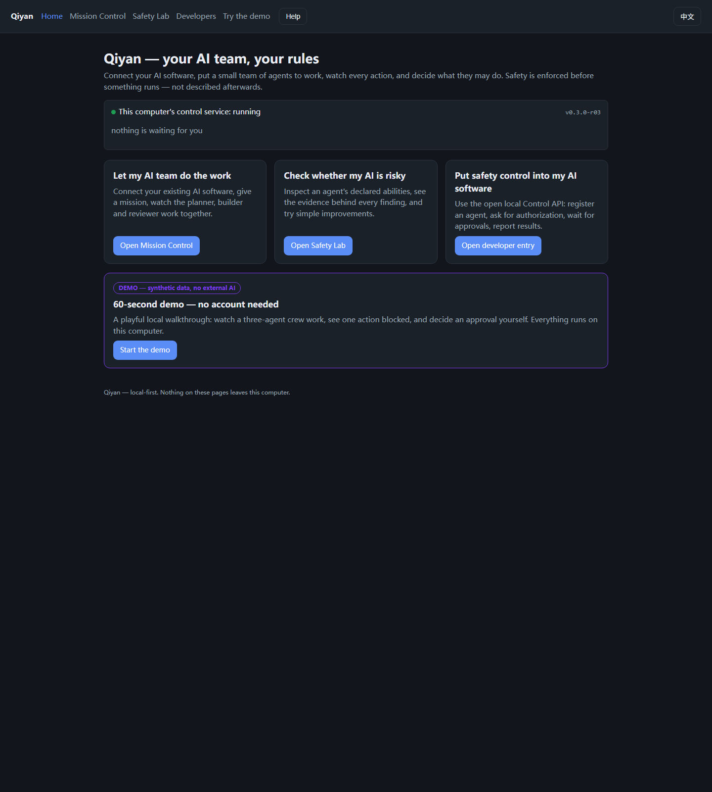
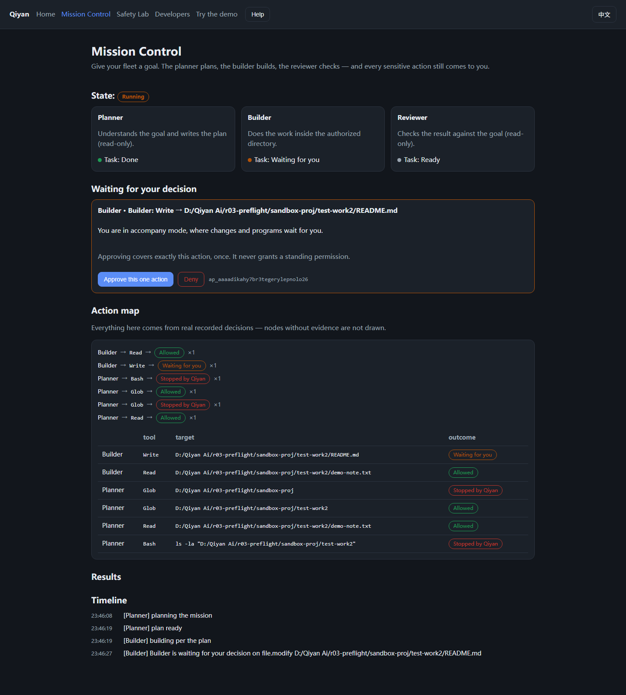
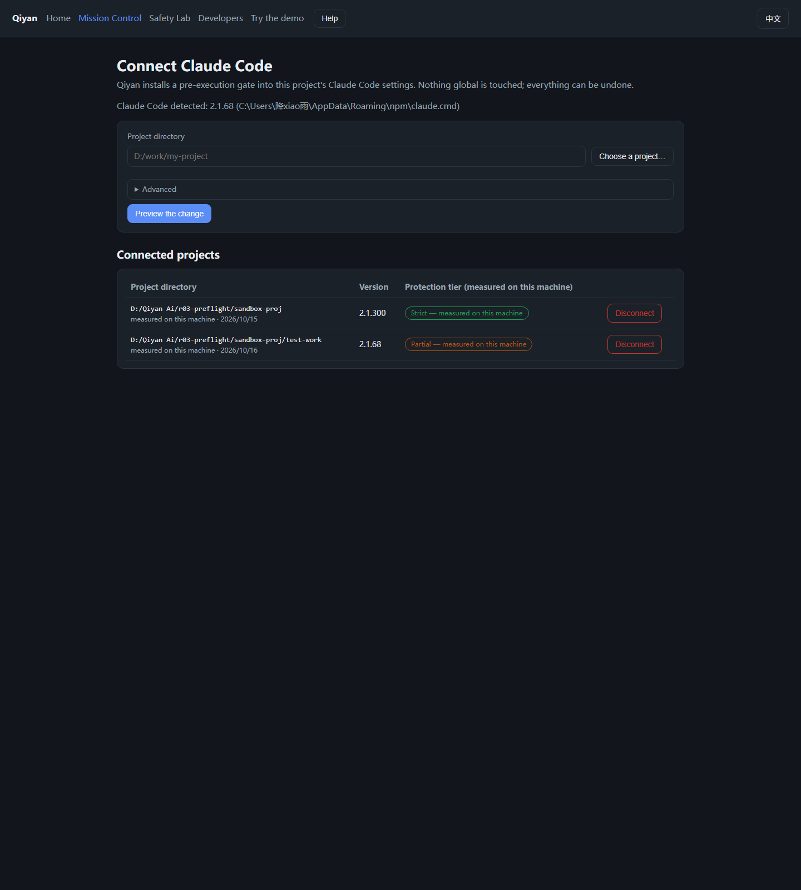

# Qiyan — Open Agent Mission & Control

**Your AI team. Your rules.**

Qiyan is a local, open platform for running AI agents under verifiable
pre-execution control: connect your existing AI software, hand a mission to a
small crew of agents, watch every action, and decide what they may do. Safety
is enforced *before* something runs — not described afterwards.

Everything is local-first: no account, no cloud, no telemetry. English and
中文 are both first-class.



## What it can do for you

- **Let a small AI team do the work.** Give one goal; a Planner, a Builder and
  a Reviewer work in three real sessions on your machine — and every sensitive
  action pauses for your decision.
- **Check whether an AI is risky.** The Safety Lab reads an agent's declared
  abilities and project wiring, attaches evidence to every finding in plain
  words, and its suggestions can be applied and *verified on your machine*.
- **Put safety control into your own software.** Any agent host can ask
  Qiyan's open, local Control API before acting: `ALLOW` runs, `DENY` stops,
  `REQUIRE_APPROVAL` waits for exactly one execution of exactly that tool call
  (supply `contentDigest` to bind the written bytes too — see the contract).

## Understand it in 30 seconds

1. **Connect** your Claude Code project (a wizard; one project file changes,
   backed up first, undoable).
2. A live probe **measures** whether dangerous actions can really be stopped on
   this machine — the version number is never trusted.
3. **Give the fleet a mission**; the Planner plans, the Builder works, the
   Reviewer checks.
4. Anything sensitive **stops and asks you** — approve once, or deny; a denied
   action stays denied for that task.
5. Every decision is **recorded with evidence**, and the console shows what is
   actually enforced — and what is not.



## Try it

**No account needed.** A 60-second synthetic demo ships inside the console:
three agents working, one action blocked, one decision you make yourself.
Synthetic content is labelled `DEMO` everywhere and can never be recorded as a
real observation.

### Run it without the Go toolchain (early access)

> **EARLY ACCESS / TEST BUILD / NOT PRODUCTION-CERTIFIED.**
> Candidates are unsigned, CGO-free test binaries for linux/amd64, linux/arm64,
> darwin/amd64, darwin/arm64 and windows/amd64, produced by the dispatch-only
> **Candidate Build** workflow (Actions → Candidate Build) and published as
> that run's downloadable workflow artifact — never as a GitHub Release, with
> no support or compatibility promise. Ask the maintainer for a run link (only
> users with write access can dispatch it). Each artifact set contains
> `CANDIDATE-LABEL.txt` (the EARLY ACCESS marking travels with the files),
> `SHA256SUMS`, and a build-provenance attestation binding each binary to its
> exact commit (`gh attestation verify <file> --repo QiyanAI/ai-agent-action-surface`).
> Windows SmartScreen and macOS Gatekeeper will warn on first run; there is no
> signing. **Keep the binary where you put it** — connected projects point at
> its absolute path, and moving or deleting it makes the gate fail closed and
> block that project's tools. Full honesty about this channel:
> [docs/scope-and-claims.md](docs/scope-and-claims.md).

Then run the file you extracted (the artifact keeps its full name; rename it
to `qiyan` if you prefer):

```sh
./qiyan_0.3.0-r03-candidate_<os>_<arch> serve
# prints the console address, the state dir and token paths
```

Open the printed console address, paste the operator token from the token file
the banner names, and start with the demo — or connect a real project as below.

### Run it from source (Go 1.27+)

```sh
go build -o qiyan ./cmd/qiyan
./qiyan serve
```

Everything is standard library only; there are no third-party dependencies to
download.

### Where it runs

CI builds and tests on **ubuntu-latest, windows-latest and macos-latest**, and
candidate builds cover the five targets above; the R02/R03 live verification
runs were performed on **Windows 11**. There is **no supported-platform list
yet** — treat other environments as unverified, not unsupported.

## Connect your own AI project

```sh
qiyan connect claude --project D:/work/my-project
```

The wizard detects Claude Code automatically (or takes an explicit binary),
shows the exact one file it will change, runs the live enforcement probe, and
only then installs. The console version has a visual project picker, plain
language, and the same rules: nothing global, one backup, undo removes exactly
what Qiyan added.



Then give the fleet a mission (console, or CLI):

```sh
qiyan mission create --goal "Read the notes and write one summary report" \
    --root D:/work/my-project
qiyan run --mission mi_...
# decisions that need you appear in the console and in `qiyan approvals list`
```

## Safety boundaries (the short, honest list)

- Only **Claude Code** is a supported runtime. Fail-closed protection needs
  **2.1.295+**; the connector probes the actual machine and refuses to claim
  what it cannot verify.
- **Shell commands always wait for your approval.** There is no name-based
  auto-allow at all, by design (see scope-and-claims for why). Commands Qiyan
  cannot interpret are never silently allowed.
- Path checks are **lexical and scope-based** — real, verified gates, but
  **not an operating-system sandbox**. If your host can bypass the Control
  API, Qiyan does not claim to control that path; the coverage table says what
  is actually enforced.
- No SaaS, no accounts, no telemetry. Nothing leaves your machine.

The full, precise list of what is and is not claimed:
[docs/scope-and-claims.md](docs/scope-and-claims.md) ·
[中文](docs/scope-and-claims.zh-CN.md).

## For developers: the open control layer

The console's **Developers** entry walks the whole flow — and there is a
guided tour for it. The interface is a local, versioned HTTP/JSON API:
`POST /v1/authorize` before acting, poll approvals, report results with
`POST /v1/events`. The repository ships a fully independent reference host:

```sh
go run ./cmd/qiyanhost --addr 127.0.0.1:8760 --token $AGENT_TOKEN \
    --mission mi_... --task ta_... --workdir D:/scratch
```

Contract documentation (endpoints, decision semantics, binding rules, error
classes, coverage, compatibility policy):
[docs/developer-api.md](docs/developer-api.md) ·
[中文 docs/developer-api.zh-CN.md](docs/developer-api.zh-CN.md).

## What is verified today

| Area | State |
| --- | --- |
| Local control service, engine, durable state | implemented, tested, verified in live runs |
| PreToolUse gate with real pre-execution blocking | verified on real Claude Code runs (deny blocks; failure modes block with `onFailure: "block"` on versions ≥ 2.1.295) |
| Three-role real fleet (Planner → Builder → Reviewer) | verified: live run producing real files with real control decisions |
| Safety Lab including verified fixes | verified: scan → preview → apply → real probe → ENFORCED coverage record → undo |
| Reference Agent Host (public API only) | verified: allow / deny / approval / rogue-bypass demonstration |
| Demo & training | synthetic, interactive, data-layer-separated from real events |
| R03 acceptance evidence | [docs/R03-ACCEPTANCE-REPORT.md](docs/R03-ACCEPTANCE-REPORT.md) |

## Repository layout

```
cmd/qiyan        the CLI: serve / hook / status / agents / approvals / mission /
                 task / session / connect / run
cmd/qiyanhost    the independent reference Agent Host (public API only)
internal/domain  identities, states, actions, policy, evidence, coverage
internal/control the single action-decision engine
internal/store   durable local state (single writer: serve)
internal/api     the versioned local Control API + embedded console
internal/connector  Claude Code detection, live probe, settings install/undo
internal/mission    the three-role fleet orchestrator
internal/lab        the Agent Safety Lab
internal/playground synthetic demo & training content (inert by construction)
```

## Security, license and contributing

Apache-2.0. Standard library only. Vulnerability reporting:
[SECURITY.md](SECURITY.md) · contribution rules: [CONTRIBUTING.md](CONTRIBUTING.md).
